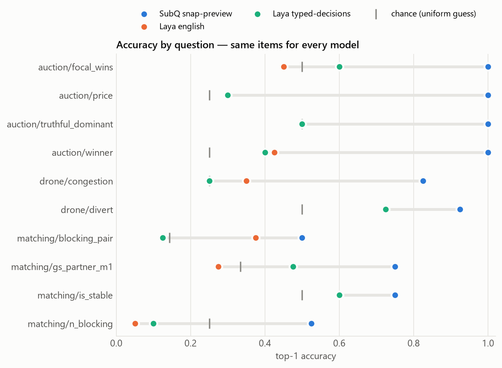
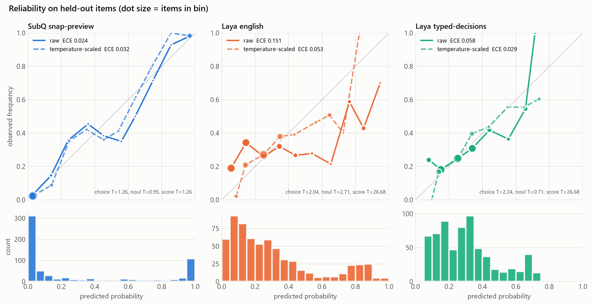
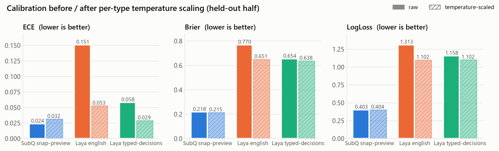
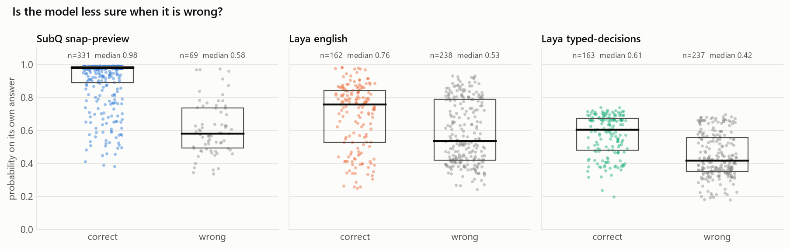
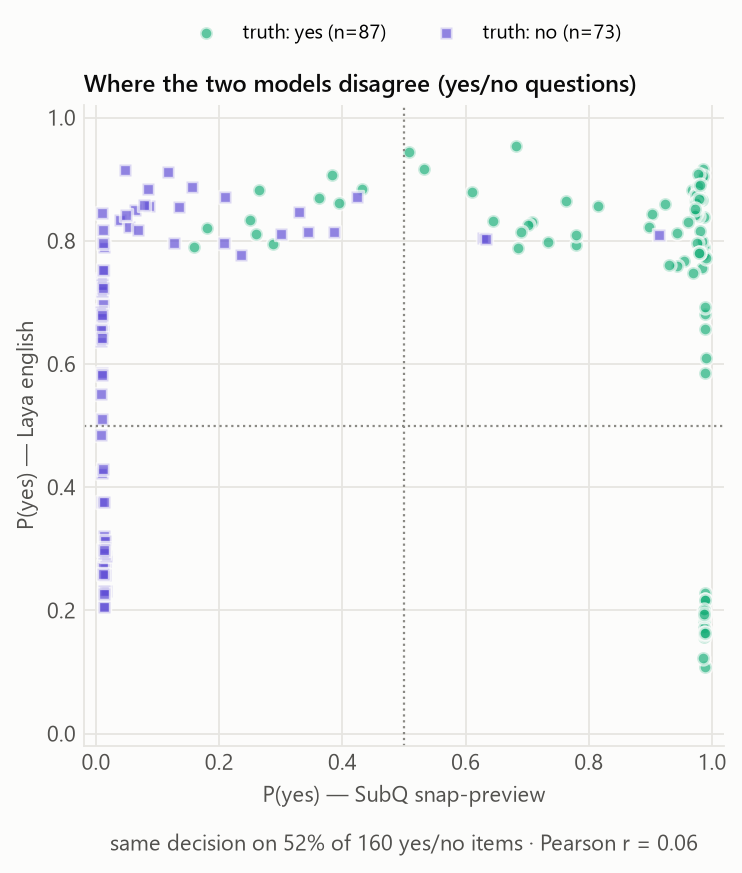
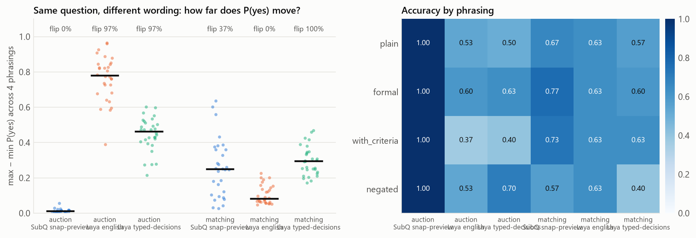
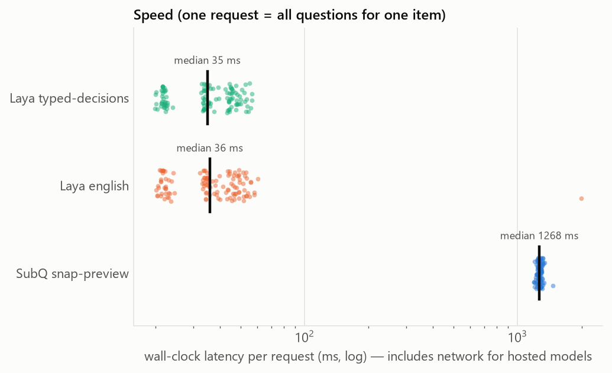

# Results

Backends: SubQ snap-preview, Laya english, Laya typed-decisions

## Calibration (held-out half, temperature fitted on the other half)

| model | n items | acc | ECE raw → scaled | Brier raw → scaled | log-loss raw → scaled | fitted T |
|---|---|---|---|---|---|---|
| SubQ snap-preview | 200 | 0.82 | 0.024 → 0.032 | 0.218 → 0.215 | 0.403 → 0.404 | choice 1.26, noul 0.95, score 1.26 |
| Laya english | 200 | 0.37 | 0.151 → 0.053 | 0.770 → 0.651 | 1.313 → 1.102 | choice 2.04, noul 2.71, score 26.68 |
| Laya typed-decisions | 200 | 0.38 | 0.058 → 0.029 | 0.654 → 0.638 | 1.158 → 1.102 | choice 2.24, noul 0.71, score 26.68 |

T > 1 means the raw probabilities were over-confident; T < 1, under-confident.

## Accuracy by question (all items)

| question | SubQ snap-preview | Laya english | Laya typed-decisions |
|---|---|---|---|
| auction/focal_wins | 1.00 | 0.45 | 0.60 |
| auction/price | 1.00 | 0.30 | 0.30 |
| auction/truthful_dominant | 1.00 | 0.50 | 0.50 |
| auction/winner | 1.00 | 0.42 | 0.40 |
| drone/congestion | 0.82 | 0.35 | 0.25 |
| drone/divert | 0.93 | 0.72 | 0.72 |
| matching/blocking_pair | 0.50 | 0.38 | 0.12 |
| matching/gs_partner_m1 | 0.75 | 0.28 | 0.47 |
| matching/is_stable | 0.75 | 0.60 | 0.60 |
| matching/n_blocking | 0.53 | 0.05 | 0.10 |

## Wording sensitivity

| model | task | n | median range of P(yes) | decision flips |
|---|---|---|---|---|
| SubQ snap-preview | auction | 30 | 0.010 | 0% |
| SubQ snap-preview | matching | 30 | 0.250 | 37% |
| Laya english | auction | 30 | 0.778 | 97% |
| Laya english | matching | 30 | 0.082 | 0% |
| Laya typed-decisions | auction | 30 | 0.463 | 97% |
| Laya typed-decisions | matching | 30 | 0.294 | 100% |

## Figures

